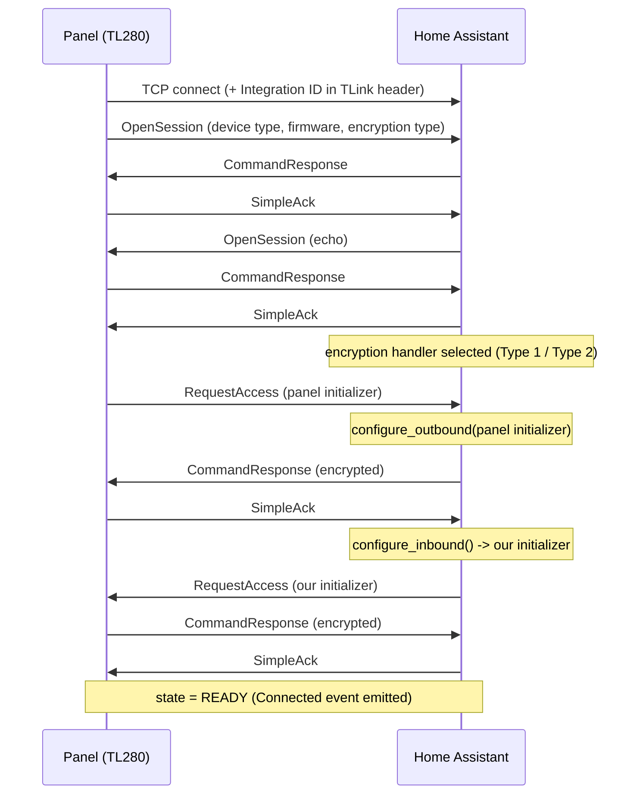

# Architecture

## Layer diagram

The panel dials in over TCP. Everything above that socket is a stack of layers,
each one talking only to its immediate neighbours.

```
DSC HS2xxx / TL280  --TCP :3072-->

  transport     server.py          ITv2Server, ITv2Connection
  session       session.py         SessionCodec, driving:
                  tlink_framing.py   byte-stuffing
                  encryption.py      AES-128-ECB
                  itv2_framing.py    length + CRC
                  crc.py             CRC-16-CCITT
                  packet.py          sender/receiver sequence numbers
  application   messages.py, serdes.py, commands.py

  ===== everything above this line is Home Assistant free =====

  HA glue       coordinator.py     DscNeoCoordinator, PanelConfigStore
                                   (storage.py), repairs.py,
                                   async_dispatcher_send(SIGNAL_*)
  entities      entity.py          DscNeoEntity, and the platforms:
                                   alarm_control_panel.py, binary_sensor.py,
                                   sensor.py, switch.py, button.py
```

## Design principles

Home Assistant is the server here, which is the thing that surprises most
people. DSC's ITv2 model has the panel dial out to an integration receiver, so
the integration binds a listening socket rather than connecting to the panel.
That means HA needs a stable IP, firewalls must allow inbound TCP on the chosen
port, and there is nothing to "connect to" until the panel decides to dial.

The protocol core does no I/O at all. `SessionCodec` is a synchronous state
machine: you `feed()` it bytes and it returns a list of events, some of which
are `BytesToSend`. It never touches a socket. That keeps the whole handshake,
framing, CRC and encryption path testable with byte literals, no network, no
event loop and no Home Assistant.

Nothing polls. `PARALLEL_UPDATES` and `DataUpdateCoordinator` polling go unused,
because state changes arrive as ITv2 notifications: the coordinator mutates its
state dicts and fires a dispatcher signal, and entities subscribe to the signals
they care about and call `async_write_ha_state()`.

All entities share `coordinator.panel_device_info`, so a Neo installation shows
up as a single device rather than dozens. And given an installer code, zone
definitions and partition assignments are read from the panel's own programming
instead of being re-entered by hand, so the panel stays the source of truth for
layout.

## The protocol stack, bottom-up

### 1. TLink framing: `tlink_framing.py`

Lowest layer over TCP. A packet is `<stuffed header> 0x7E <stuffed payload>
0x7F`, with PPP-style byte-stuffing (`0x7D`->`0x7D 00`, `0x7E`->`0x7D 01`,
`0x7F`->`0x7D 02`). The header carries the 12-byte ASCII Integration ID.

`extract_packet(buffer)` peels one packet off a stream buffer and returns the
leftover; `parse_all()` drains as many as are complete.

### 2. Encryption: `encryption.py`

AES-128-ECB with `PaddingMode.None` and **per-direction session keys** derived
during the handshake.

- **Type 2**: the 32-hex-char access key is used directly as the AES key. Each
  side sends a random 16-byte initializer;
  `session_key = AES(access_key, initializer)`.
- **Type 1**: keys are derived from the Integration ID and the 8-digit access
  code via `first8 * 4` hex-decoded. Each side sends a 48-byte initializer
  (16 check bytes + 32 ciphertext bytes); the receiver decrypts, verifies the
  even-indexed plaintext bytes match the check bytes, and uses the odd-indexed
  bytes as the session key. A check-byte mismatch means wrong credentials.

### 3. ITv2 framing: `itv2_framing.py`

Inside each encrypted payload: `<length prefix> <packet> <CRC-16 BE>`. The
length prefix is one byte if <= `0x7F`, otherwise two bytes with the high bit of
the first set. The declared length includes the 2 CRC bytes, which lets the
receiver ignore the zero-padding AES-ECB adds.

### 4. CRC: `crc.py`

CRC-16-CCITT (False): poly `0x1021`, init `0xFFFF`, MSB-first, no final XOR,
stored big-endian.

### 5. Packet header: `packet.py`

`[sender_seq][receiver_seq][command:u16 BE][body...]`, with a 2-byte special case:
any packet of exactly two bytes is an implicit `Simple_Ack` carrying only the
sequence pair.

### 6. Messages: `messages.py`, `serdes.py`, `commands.py`

`commands.py` holds the 170-entry `Command` IntEnum. `messages.py` defines a
frozen dataclass per message with a class-level `COMMAND`, plus two registries:

```python
ENCODERS: dict[type, Callable[[Any], bytes]]
DECODERS: dict[int, Callable[[bytes], Any]]

encode_message(msg) -> (command_id, body_bytes)
decode_message(command, body) -> message | None
```

Unknown commands decode to `DefaultMessage(command, data, deserialization_error)`
rather than raising, so an unrecognised panel message never kills the session.

`serdes.py` implements DSC's wire primitives: big-endian ints, "compact
integers" (`[len][significant bytes]`), BCD strings, UTF-16BE length-prefixed
strings and arrays, and a 32-bit packed date/time (5/6/6/6/4/5 bits for
hour/min/sec/year-2000/month/day, valid 2000-2063).

## The handshake

`SessionCodec` drives a nine-state machine. Abbreviated:



After `READY`, the panel streams notifications and the integration may send
commands. Sender/receiver sequence bytes are tracked on both sides;
`_local_sequence` wraps 1->255 and skips 0.

Codec events surfaced to the coordinator: `Connected`, `Notification`, `Closed`,
`Failed`. (`BytesToSend` is consumed inside `ITv2Connection`.)

## Coordinator

`DscNeoCoordinator` owns the `ITv2Server`, the reconnect policy and all panel
state.

State it maintains:

| Attribute | Type |
|---|---|
| `zones` | `dict[int, ZoneState]` |
| `partitions` | `dict[int, PartitionState]` |
| `trouble` | `TroubleState` (group id -> bitmap byte) |
| `zone_labels` / `partition_labels` | `dict[int, str]` |
| `zone_definitions`, `zone_partition_assignment`, `zone_attributes_*` | from installer read |
| `pgm_types`, `pgm_partition_assignment` | from installer read |
| `connection_state` | `disconnected` \| `handshaking` \| `connected` \| `failed` |
| `panel_firmware`, `panel_session_id`, `panel_datetime` | from handshake / notifications |
| `max_zones`, `max_partitions`, `max_users` | panel capabilities |

Dispatcher signals (each suffixed with the entry id):

`dsc_neo_itv2_zone_update`, `_partition_update`, `_connection_update`,
`_new_zone`, `_trouble_update`.

Entity platforms subscribe on `async_added_to_hass()` via the shared
`DscNeoEntity` base and add newly discovered zones/partitions dynamically on
`_connection_update`.

## Reconnect and failure handling

- Panel disconnects are normal (poll intervals, installer-mode exits). The
  server keeps listening; the coordinator marks entities unavailable.
- Repeated failures are logged once per failure window rather than per attempt,
  to avoid log storms.
- Disconnect reasons matching `repairs.is_auth_failure_reason()` raise a Repairs
  issue and start a reauth flow instead of retrying forever with bad keys.
- Trouble bitmaps are diffed each update and synced to Repairs issues
  idempotently.

## Stale entity pruning

After a panel-config read or a cache hydrate, `async_prune_stale_entities()`
removes registry entries for zones whose definition is `0` and partitions that
are not enabled, so re-programming the panel doesn't leave orphan entities
behind.
